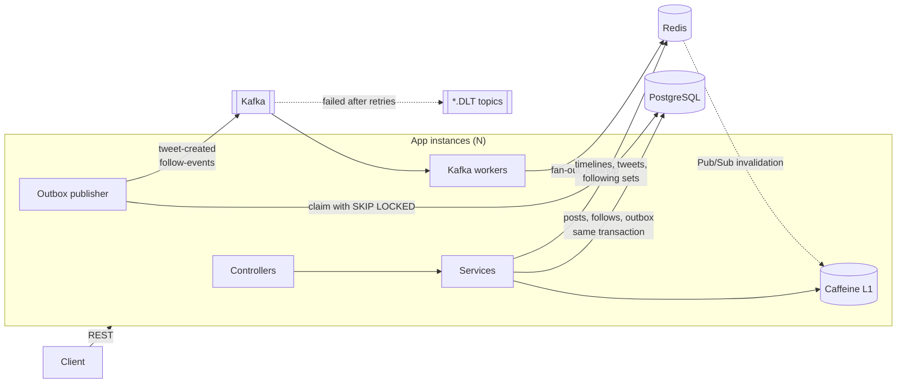

# Twitter Home Timeline — System Design, Built for Real


A backend for the hardest part of Twitter/X: the **home timeline**. Every classic system design problem around
it — fan-out, celebrities, hot keys, cache stampedes, Redis outages, lost events, multi-instance cache
consistency — is not just drawn on a whiteboard here but **implemented, broken on purpose and measured**.

The project was built in 21 iterations. Each one started from a concrete failure scenario
("what happens when a celebrity with 20M followers tweets?", "what if Redis dies?", "what if an instance misses
an invalidation message?"), discussed the trade-offs, then shipped the fix and verified it against the running
system (two app instances, real Kafka and Redis).

---

## Highlights

- **Hybrid fan-out** — push (fan-out on write) for normal accounts, pull (fan-out on read) for celebrities,
  merged at read time with correct cursor paging, even across trimmed caches.
- **Transactional outbox → Kafka** — no lost or phantom events; claim/send/mark publisher with
  `FOR UPDATE SKIP LOCKED`, async batch sends, retries, dead-letter topics and a replay switch.
- **Snowflake ids** with worker ids **leased from PostgreSQL** (heartbeat + local validity, clock-rollback guard).
- **Three-tier read path** — Caffeine (L1, in-process) → Redis (L2) → PostgreSQL, one Redis round trip per page.
- **Cache stampede protection** — per-key request coalescing in-process plus a cluster-wide Redis lock with
  double-check.
- **Graceful degradation** — 200 ms Redis timeouts, a circuit breaker, and a **bulkhead-limited** SQL fallback so
  a Redis outage cannot become a PostgreSQL outage.
- **Cross-instance L1 invalidation over Redis Pub/Sub** — with heartbeat and disconnect detection: while
  messages may be lost, L1 is bypassed; on reconnect it is cleared before being trusted again.
- **Idempotent, ordered event handling** — events keyed so related changes stay in one partition; every
  consumer is safe to run twice; fan-out resumes from a checkpoint after a crash.
- **Tweet edit & delete** with "delayed double delete" cache invalidation across Redis and every instance's L1.

---

## Architecture



**Write path** (`POST /posts`):

1. The post and a `TweetCreated` event are written to PostgreSQL **in one transaction** (transactional outbox).
2. The outbox publisher claims pending rows and sends them to Kafka, keyed by author.
3. `FanoutWorker` pushes the tweet id into every follower's Redis timeline — or, for a celebrity, into the
   celebrity's own posts list once, then publishes an L1 invalidation to all instances.

**Read path** (`GET /timeline`):

1. One pipelined Redis round trip reads the user's precomputed timeline; a second reads whom they follow.
2. The celebrities among them come from an in-memory set; their posts lists come from L1 (Redis on a miss).
3. All sources are merged newest-first (Snowflake ids sort by time), tweet content is resolved
   L1 → Redis `MGET` → PostgreSQL, and only what the caches cannot cover is filled by SQL.

---

## Problems solved

| # | Problem | Solution |
|---|---------|----------|
| 1 | Timeline as a SQL JOIN does not scale with reads | Fan-out on write into Redis sorted sets (ids zero-padded, lexicographic order = time order, `ZREVRANGEBYLEX` cursors), capped at 800 entries |
| 2 | Lost or phantom events when DB and Kafka writes are separate | Transactional outbox; short claims (`locked_until`, `SKIP LOCKED`) so several publishers never block each other; async batch sends; 7-day cleanup |
| 3 | Unique, time-ordered ids across instances without a DB sequence | Snowflake (41-bit time, 10-bit worker, 12-bit sequence); worker ids leased from PostgreSQL with heartbeat; clock-rollback detection |
| 4 | A celebrity's tweet would mean millions of writes | Hybrid fan-out: celebrities (sticky flag at a follower threshold) are pulled at read time; merging handles trimmed caches with a "floor" so no tweet is skipped |
| 5 | Unfollow / new follow leave the timeline wrong | Follow and unfollow share one topic keyed by follower (ordered); unfollow removes the followee's tweets, follow backfills recent ones |
| 6 | Timelines of inactive users waste memory and fan-out writes | Sliding 7-day TTL; writers only touch keys that exist (Lua `ADD_IF_EXISTS`); missing keys are rebuilt on read |
| 7 | Worker crash mid fan-out; poison messages | Fan-out checkpoint per event; retries with back-off, then dead-letter topics; operator-controlled replay endpoint |
| 8 | Tweet content read from PostgreSQL for every timeline item | `tweet:{id}` JSON cache read with one `MGET`, warmed after commit |
| 9 | Hot row: a follower counter updated on every follow | Counted asynchronously by a batch consumer, one aggregated `UPDATE` per account, deduplicated by event id |
| 10 | Many sequential Redis calls per request | All timeline sources read in one pipelined round trip |
| 11 | Hot keys: one celebrity read by millions | Caffeine L1 per instance: Redis load scales with the number of instances, not users |
| 12 | Cache stampede on expiry | In-process request coalescing (async cache) + Redis lock with double-check + jittered short wait |
| 13 | Redis slow or down takes the whole app with it | 200 ms timeouts, connection pool, circuit breaker, SQL fallback behind a bulkhead (503 instead of overloading PostgreSQL) |
| 14 | L1 copies on N instances disagree after a change | Invalidation messages over Redis Pub/Sub (keys only, never data) |
| 15 | Pub/Sub is not durable: a disconnected instance misses messages | Disconnect events + self-heartbeat; L1 bypassed while untrusted, cleared on reconnect; TTL as the last safety net |
| 16 | "Which celebrities does this user follow?" queried on every request | Following set cached in Redis + in-memory celebrity directory: no DB query on the hot path |
| 17 | Empty timelines re-queried on every read | Sentinel member keeps empty lists cached |
| 18 | A fan-out racing an unfollow re-inserts a tweet after cleanup | Read-time filter: only tweets from the user or accounts they follow are shown |
| 19 | Edits and deletes must reach every cache | Evict right after commit (fast) and again from the outbox event (guaranteed, fixes the cache-aside race) |

---

## Measured on the running system

Verified locally against two app instances with real Kafka and Redis (not unit tests — the actual behaviour):

| Scenario | Result |
|----------|--------|
| 30 concurrent requests on 2 instances, cold celebrity cache | **1** SQL rebuild in total (stampede protection) |
| Repeated timeline reads | **0** SQL for tweet content (Redis), **0** Redis `MGET` on repeat (L1) |
| 900 parallel requests | **900/900** succeeded, no false circuit-breaker trips (after adding the connection pool) |
| New celebrity tweet, L1 TTL 30 s | Visible on the **other instance within 3 s** (Pub/Sub invalidation) |
| Redis paused for 5 s | L1 marked untrusted after 3 s, cleared and trusted again when Redis returned |
| Silent change in Redis + dropped subscription | Stale L1 entry removed on reconnect |
| Tweet edited on instance A | New text served by **instance B 0.5 s later** |
| User who follows nobody | **0** SQL after the first read |
| Late fan-out after unfollow | Tweet stays in Redis but is **never shown** |

---

## Tech stack

| Area | Choice |
|------|--------|
| Language / framework | Java 26, Spring Boot 4.1 (Web MVC, Data JPA / Hibernate 7, Validation, Actuator) |
| Storage | PostgreSQL, schema managed only by Liquibase (`ddl-auto=validate`) |
| Messaging | Apache Kafka 3.9 (KRaft), Spring Kafka, idempotent producer, `acks=all` |
| Cache | Redis 7.4 (Lettuce, pooled), Caffeine `AsyncCache` |
| Resilience | Resilience4j circuit breaker and bulkhead |
| Build | Gradle (Groovy DSL) |

## Redis data model

| Key / channel | Type | Purpose |
|---------------|------|---------|
| `timeline:user:{id}` | sorted set (≤ 800, TTL 7 d sliding) | Push part of the home timeline |
| `posts:user:{id}` | sorted set (≤ 200, TTL 1 d) | A celebrity's recent tweets, pulled by followers |
| `tweet:{id}` | string (JSON, TTL 24 h) | Tweet content |
| `following:user:{id}` | set (TTL 7 d sliding) | Whom a user follows |
| `lock:rebuild:…` | string (`SET NX PX 5000`) | Cluster-wide rebuild lock |
| `fanout:progress:{eventId}` | string (TTL 1 h) | Fan-out checkpoint |
| `cache-invalidation` | Pub/Sub channel | L1 invalidations (+ per-instance heartbeat channels) |

## API

All user-facing calls identify the caller with the `X-User-Id` header (a development stand-in for auth).

| Method | Path | Description |
|--------|------|-------------|
| `POST` | `/users` | Create a user |
| `GET` | `/users/{id}` | User profile |
| `PUT` / `DELETE` | `/users/{id}/follow` | Follow / unfollow |
| `GET` | `/users/{id}/followers`, `/users/{id}/following` | Follow graph (cursor paging) |
| `POST` | `/posts` | Tweet |
| `GET` | `/posts/{id}` | One tweet |
| `PUT` / `DELETE` | `/posts/{id}` | Edit / delete (author only) |
| `GET` | `/users/{id}/posts` | Profile timeline |
| `GET` | `/timeline?cursor=&limit=` | Home timeline |
| `GET` | `/admin/cache/l1` | Inspect this instance's L1 caches |
| `POST` | `/admin/dlt/replay/start` / `stop` | Replay dead letters |

A ready-to-use Postman collection is in [`docs/postman`](docs/postman/twitter.postman_collection.json).

---

## Run locally

Prerequisites: JDK 26, Docker, PostgreSQL on `localhost:5433` with a database named `twitter`.

1. Start Kafka and Redis (details in [`docker/README.md`](docker/README.md)):

   ```bash
   docker compose -f docker/docker-compose.yml up -d
   ```

2. Run the app; Liquibase creates the schema on startup. Database settings can be overridden with the standard
   Spring variables (`SPRING_DATASOURCE_URL`, `SPRING_DATASOURCE_USERNAME`, `SPRING_DATASOURCE_PASSWORD`):

   ```bash
   ./gradlew bootRun
   ```

3. Start a second instance to see multi-instance behaviour:

   ```bash
   SERVER_PORT=8081 ./gradlew bootRun
   ```

| Variable | Default | Meaning |
|----------|---------|---------|
| `SERVER_PORT` | `8080` | HTTP port |
| `REDIS_HOST` / `REDIS_PORT` | `localhost` / `6380` | Redis |
| `KAFKA_BOOTSTRAP_SERVERS` | `localhost:9092` | Kafka |
| `CELEBRITY_THRESHOLD` | `10000` | Followers needed to become a celebrity (pull model) |
| `TIMELINE_SQL_FALLBACK_MAX_CONCURRENT` | `20` | Bulkhead size for SQL timelines while Redis is down |

## Project structure

```
src/main/java/az/twitter
├── controller   REST endpoints (incl. admin)
├── service      timeline merge, posts, follows, cache invalidation, celebrity directory
├── repository   JPA repositories and Redis structures (SortedIdCache, content cache, locks, …)
├── worker       outbox publisher, fan-out, follow/unfollow, follower count, DLT replay, cleanup jobs
├── config       Kafka topics & error handling, L1 caches, Pub/Sub subscription
├── util         Snowflake generator, worker-id lease, Redis circuit breaker
├── entity, dto, security, exception
src/main/resources/db/changelog   Liquibase changesets
docker/                           Kafka + Redis for local runs
docs/                             design notes, reference material, Postman collection
```

---

## Trade-offs and known limitations

- **Eventual consistency by design**: timelines are updated asynchronously (typically well under a second).
- A user whose timeline is shorter than a page reaches its end on every read and pays one SQL query there:
  backfills are partial, so the cache cannot prove it holds everything.
- The celebrity directory is held in memory by each instance — right for thousands of celebrities; at millions it
  would move to Redis.
- Authentication is a header stand-in; admin endpoints are open. Kafka and Redis run as single nodes locally.

## Roadmap

- **Sharding** PostgreSQL by `user_id` and dealing with hot shards.
- **Observability**: Micrometer → Prometheus → Grafana (cache hit rates, breaker state, outbox age, consumer lag,
  DLT size) with alerts.
- Real authentication, rate limiting, automated integration tests with Testcontainers.
